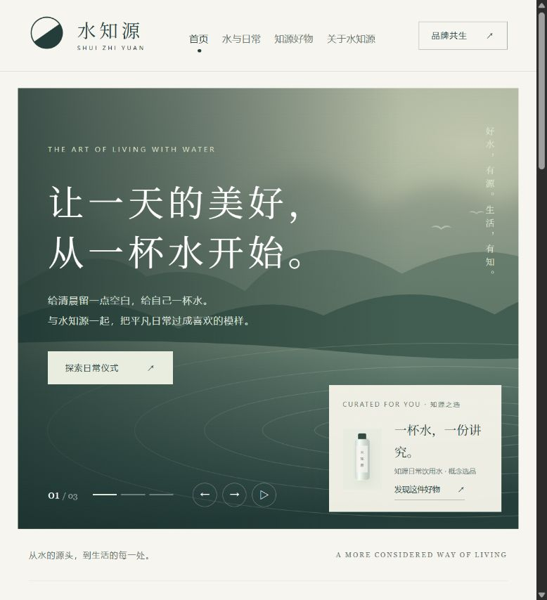

# 水知源 · 前端概念原型

面向品质生活人群的水主题品牌网站。采用原生 HTML、CSS、JavaScript，无构建或第三方依赖。

## 本地启动

在项目根目录执行：

```powershell
python -m http.server 4173 --bind 127.0.0.1
```

浏览器访问 http://127.0.0.1:4173 。也可以直接打开 index.html。

## 首页预览



## 已实现

- 响应式首页，三组活动轮播、手动切换及自动播放暂停；减少动态效果偏好下默认暂停。
- 首页右下角精选产品推荐。
- 活动分类、独立详情、每日打卡和筹备活动收藏。
- 产品分类、独立详情与本机心愿单。
- 品牌理念、合作意向表单预览、合作伙伴工作台。
- 本地 CSS / SVG 风景和产品概念包装，无外部图片、字体请求。
- 哈希路由，浏览器前进后退可用。

## 原型边界

产品、包装与线下活动为概念方案；没有虚构已合作品牌、产品资质或功效。工作台数据均为演示数据。合作表单不联网、不保存、不提交联系方式。打卡、收藏、心愿单仅保存在当前浏览器；存储被禁用时回退到当前页面内存，并提示用户。

当前无后端、认证、支付、真实报名、品牌入驻审核或数据隔离。上线前需确认品牌视觉、产品来源与资质、实际活动安排，并实现真实业务接口和企业权限隔离。

## 后续建议

1. 先确定核心产品线与首批活动，建立清楚的品牌选品标准。
2. 接入真实产品图、源头故事与可核实的产品资料。
3. 完善会员端报名、活动提醒与服务咨询。
4. 品牌合作初期采用邀请与审核制，再接入各品牌自己的数据看板。

品牌名统一为「水知源」。
